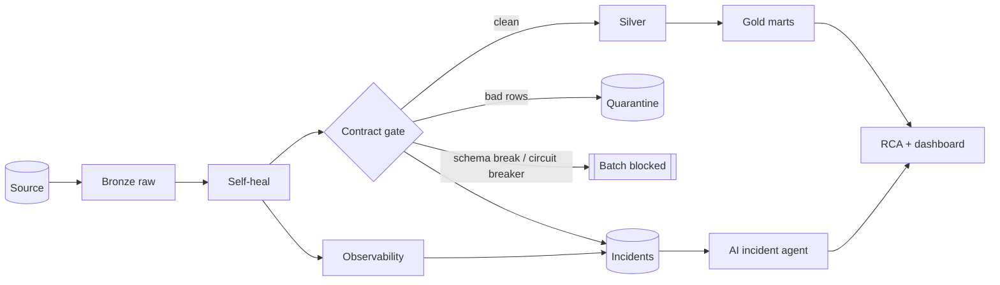

<div align="center">

# LakehouseGuard

**A contract-driven, self-healing Medallion lakehouse with an offline-first AI incident agent.**
Bad data is blocked, explained and fixed faster than anyone can open a dashboard.

[](https://github.com/AnyalstRushi/lakehouseguard/actions/workflows/ci.yml)
[](https://anyalstrushi.github.io/lakehouseguard/)


</div>

## Why this exists

Most pipelines are tested at build time and trusted at run time. In production the damage comes from data that is *late, duplicated, renamed, rescaled or quietly different*,
and from alerts nobody can interpret. LakehouseGuard is the reliability layer around a lakehouse:

| Layer | What it does |
|---|---|
| **Data contracts** (YAML) | Gate Bronze to Silver. Bad rows go to a **Quarantine** with the exact rules they broke, never silently dropped |
| **Self-healing with guardrails** | Fixes only unambiguous problems (whitespace, casing, `Bangalore` to `Bengaluru`, `₹1,234.50` to `1234.5`) and raises an incident if too much needs fixing |
| **Circuit breaker** | If more than 50% of a batch fails, the whole batch is held: a heavily filtered partial batch would bias KPIs |
| **Observability** | Freshness, volume (robust z-score), null drift, schema drift and **silent distribution drift** (PSI) that contracts cannot see |
| **AI incident agent** | Collapses alerts to one root cause, ranks hypotheses with evidence, retrieves the runbook (TF-IDF RAG), sizes the blast radius, suggests a first patch. **No API key needed** |
| **FinOps + lineage** | Cost per run and wasted spend, OpenLineage-style events |

## Try it in 60 seconds

```bash
pip install -e .
lakehouseguard demo                       # 10 healthy batches, then 9 ways to break the pipeline
open site/index.html                      # dashboard (no server needed)
lakehouseguard rca                        # root-cause analysis of the latest incident
lakehouseguard ask "why did revenue drop?"
lakehouseguard ask "how do I fix a schema break?"
```

Or with Docker: `docker compose up --build` and open http://localhost:8080.

## What the agent produces

```text
### INC-8140E4DB · schema_break · CRITICAL
**Required column(s) missing: amount**

Most likely causes
- 75%: Upstream renamed amount to order_amount without a contract version bump
       (evidence: a column vanished while a new one appeared in the same batch)
- 25%: Source API or extraction query version changed

Blast radius
- Rows affected: 1209 of 1209 (100%); batch status: blocked
- Downstream assets: silver.orders, quarantine.orders, gold.fact_sales_daily, gold.kpi_daily

Remediation (from runbook) ...      Suggested starting point: df.rename(columns={'order_amount': 'amount'})
```


## Architecture



Details: [architecture](docs/architecture.md) · [contracts](docs/data-contracts.md) · [observability](docs/observability.md) · [agent](docs/agent.md) · [Azure / Databricks / Fabric mapping](docs/azure-fabric-mapping.md) · [ADRs](docs/adr/)

## Results

Reproduce: `python benchmarks/run_benchmark.py --seeds 20`. Synthetic, seeded data.

| Metric | Result |
|---|---|
| Failure batches injected (9 failure modes x 20 seeds) | 180 |
| Detected, with the expected incident type | **100%** |
| False positives on healthy batches | **0 of 100** |
| Alerts removed by causal triage | 254 to 180 (**29% fewer**) |
| Row-level gate on null burst (recall / precision) | 100% / 100% |
| Row-level gate on 400x outliers (recall / precision) | 73% / 100% |
| Throughput, pure-Python engine | ~33k rows/s |

**Read the caveats** in [benchmarks/RESULTS.md](benchmarks/RESULTS.md): the failure modes and detectors share an author, so 100% means "catches what it was designed against", not "catches everything". The 73% outlier recall is a genuine limitation (some outliers stay below a global `max`).

Quality: 98 tests, 100% line coverage (stdlib tracer; parquet-only branches excluded; CI enforces 90% with coverage.py). Developed and tested on Python 3.12 with pandas 3.0; CI runs 3.11 and 3.12 with ruff.

## The nine failure modes in the demo

`null_burst` · `schema_drift` (a rename) · `type_drift` · `duplicate_flood` · `volume_drop` · `outlier_amount` · `stale_data` (timezone shift) · `format_drift` (auto-healed, but flagged) · `silent_drift` (every value valid, distribution moved 1.8x: only observability sees it)

## Use it on your own data

```bash
lakehouseguard validate my_extract.csv --contract contracts/orders.yaml   # exit 2 on violations: drop into producer CI
```

```python
from lakehouseguard.contracts import Contract
from lakehouseguard.pipeline import Pipeline

pipe = Pipeline("lakehouse_data", Contract.from_yaml("contracts/orders.yaml"))
result = pipe.run_batch(df, run_ts)         # idempotent per batch_id
print(result.status, result.incident_types)
```

Optional extras: `pip install -e ".[parquet]"` (Parquet storage), `".[spark]"` (see `examples/spark_engine.py`). Local LLM phrasing: `lakehouseguard ask "..." --ollama llama3.1`.

## Repo map

```
src/lakehouseguard/   contracts · healing · observability · pipeline · agent · report · cli · generator · demo
src/lakehouseguard/knowledge/   runbooks the agent retrieves from
contracts/            orders.yaml (the data contract)
tests/                98 tests (unittest style, run with pytest)
benchmarks/           reproducible benchmark + RESULTS.md
examples/             PySpark + Delta gate, Airflow DAG (reference, see notes)
docs/                 architecture, ADRs, Azure mapping, interview guide
.github/workflows/    CI (lint, tests, coverage, benchmark smoke) and GitHub Pages dashboard
```

## Honest limits and roadmap

- Pandas core is single-process; the Spark example is a reference that runs in an optional CI job.
- The agent is a playbook plus retrieval, not a learner; confidence is a normalised weight, not a calibrated probability.
- Roadmap: per-segment range rules, embedding retrieval, incremental Gold, dbt-core Gold, OpenLineage to Marquez, auto-created tickets.

MIT licensed. Built by [Rushikesh Wavhal](https://github.com/AnyalstRushi).
