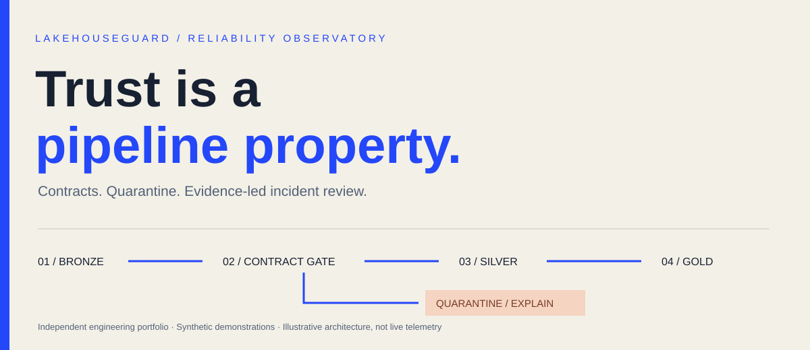
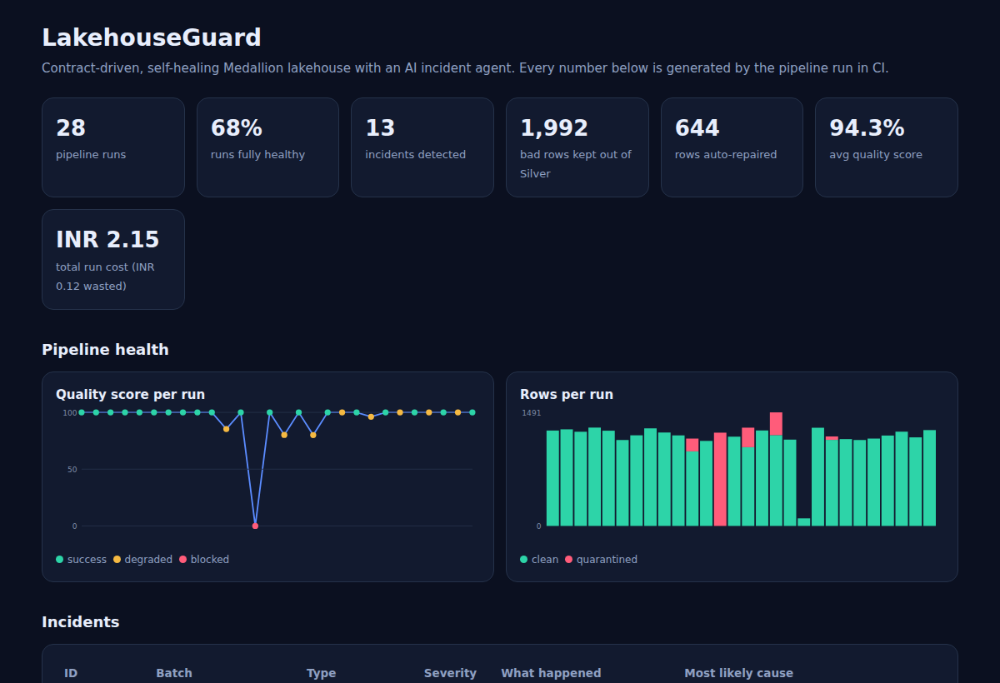
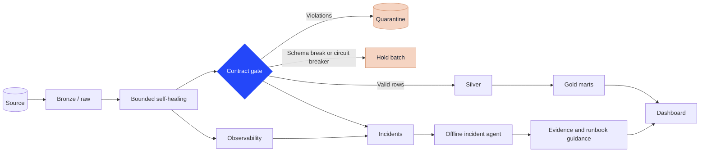
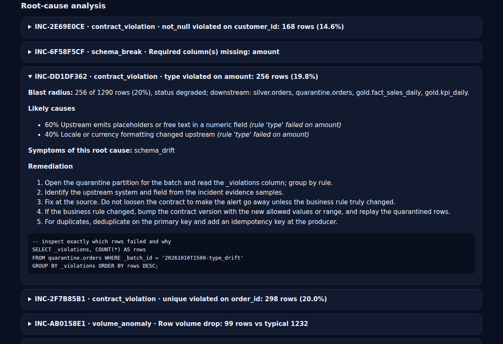

# LakehouseGuard

Contract-driven lakehouse reliability: validate data, quarantine violations, investigate incidents, and keep remediation bounded by explicit rules.

[Dashboard HTML](sample-dashboard.html) · [PowerPoint deck](LakehouseGuard_Deck.pptx) · [PDF presentation](LakehouseGuard_Deck.pdf) · [Architecture](architecture.md) · [Benchmark evidence](RESULTS.md)

> Repository status: source files currently live at the repository root. Package structure, installation commands, CI execution and public deployment require verification. An HTML source link is not a running website. No live deployment or passing-test claim is made here.

## 01 / See the system

This is the repository's existing dashboard image, not a live operational feed. The demonstration and reported benchmark use synthetic data.

## 02 / Follow the decision

The diagram describes the project design. It is not evidence that every component has executed successfully in this checkout.

| Reliability boundary | Intended behavior | Read the specification |
|---|---|---|
| Contract gate | Route failing records to quarantine with rule context | [Data contracts](data-contracts.md) |
| Bounded healing | Normalize unambiguous formats; flag excessive repair | [Healing decision](0005-self-healing-with-guardrails.md) |
| Circuit breaker | Hold heavily failing batches rather than publish biased partial results | [Circuit-breaker decision](0004-circuit-breaker.md) |
| Observability | Inspect freshness, volume, schema and distribution drift | [Observability](observability.md) |
| Incident review | Retrieve runbooks and rank evidence-backed hypotheses | [Agent design](agent.md) |

## 03 / Inspect the incident output

The repository describes schema-break investigation, affected downstream assets and suggested remediation. Hypothesis weights are not calibrated probabilities; a proposed patch is not proof of successful or safe automatic repair.

[Schema-break runbook](schema_break.md) · [Contract violations](contract_violation.md) · [Distribution drift](distribution_drift.md) · [Freshness breach](freshness_breach.md)

## 04 / Evidence before scores

Inspect [RESULTS.md](RESULTS.md), [results.json](results.json) and [run_benchmark.py](run_benchmark.py) together before repeating benchmark claims. Earlier README figures have not been rerun as part of this visual refresh.

Synthetic injected-failure detection does not establish production accuracy. Detection coverage depends on the injected cases; throughput depends on the execution environment. Retain limitations rather than turning benchmark numbers into universal guarantees.

## 05 / Present the project

- [Editable PowerPoint](LakehouseGuard_Deck.pptx)
- [PDF deck](LakehouseGuard_Deck.pdf)
- [Existing dashboard HTML source](sample-dashboard.html)
- [Interview guide](interview-guide.md)
- [Azure / Databricks / Fabric mapping](azure-fabric-mapping.md)

These links point to existing repository files. The decks' contents and browser rendering have not been audited in this refresh.

## 06 / Engineering decisions

[Contracts at Bronze–Silver](0001-contracts-at-bronze-silver.md) · [Healthy-run baselines](0002-baseline-from-healthy-runs.md) · [Offline-first agent](0003-offline-first-agent.md) · [Pure-Python storage](0006-pure-python-core-and-storage.md)

## Current checkout and next verification

The current root contains Python modules, tests, runbooks, images and workflow YAML files. Earlier documentation referenced directories that are not present in this checkout.

- [x] Link the front-page images and decks to existing paths.
- [x] Add a distinct Observatory visual identity and readable architecture.
- [ ] Restore the intended package/test/runbook directory structure after reviewing imports and configuration.
- [ ] Install and run lint, tests and benchmark smoke checks.
- [ ] Review root ci.yml and pages.yml before enabling them under .github/workflows/.
- [ ] Verify a deployed interactive dashboard.
- [ ] Add a verified animated demo capture, with a static fallback.

No generated GIF or live animation is claimed by this update. The illustrated hero and architecture are static; interactive behavior belongs in a separately verified web experience.

## License

[MIT](LICENSE). Built by [Rushikesh Wavhal](https://github.com/AnyalstRushi).
