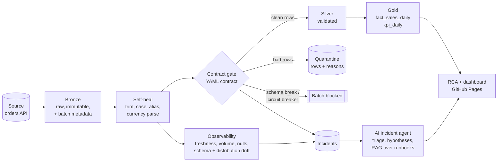

# Architecture

LakehouseGuard treats data quality as a **platform property**, not a notebook afterthought. Every batch passes
through the same gate, and every decision is recorded.

## Layers

| Layer | What lives there | Write mode |
|---|---|---|
| Bronze | Raw batch exactly as received + `_batch_id`, `_ingested_at` | Per-batch partition, overwrite on replay |
| Silver | Rows that passed the contract (after safe auto-repair) | Per-batch partition, overwrite on replay |
| Quarantine | Rejected rows + `_violations` (every rule each row broke) | Per-batch partition |
| Gold | `fact_sales_daily` (date x city x category), `kpi_daily` | Full deterministic rebuild from Silver |
| Ops | `runs.jsonl`, `incidents.jsonl`, `lineage.jsonl`, baseline profiles + reference sample | Append-only logs |

Replaying a batch with the same `batch_id` overwrites its partitions and rebuilds Gold, so **every run is idempotent**.
Retries and backfills cannot double-count.

## Decision policy

| Situation | What the platform does |
|---|---|
| Row breaks a rule | Row goes to Quarantine with the rule names; the rest of the batch continues |
| Required column missing (schema break) | Whole batch blocked, nothing reaches Silver, critical incident |
| More than 50% of rows fail (circuit breaker) | Whole batch blocked: a heavily filtered partial batch would bias Gold KPIs |
| Value is repairable without guessing | Auto-repaired and counted; >10% repaired raises `high_heal_rate` |
| Data is valid but behaves differently (drift, volume, freshness) | Published, incident raised (observability alerts, contracts block) |
| Batch raised any incident | Not used to update the baseline, so bad data cannot teach "normal" |

## Incident types

`schema_break`, `contract_violation`, `freshness_breach`, `volume_anomaly`, `null_rate_drift`, `distribution_drift`,
`high_heal_rate`, `schema_drift`. Each has a runbook in `src/lakehouseguard/knowledge/`.

## Module map

| Module | Responsibility |
|---|---|
| `contracts.py` | YAML contract model, row-level validation, circuit breaker |
| `healing.py` | Deterministic, auditable repairs |
| `observability.py` | Baseline, detectors, PSI |
| `pipeline.py` | Orchestrates one batch end to end, idempotent |
| `incidents.py`, `lineage.py`, `cost.py` | Incident store, OpenLineage-style events, FinOps model |
| `agent.py` | Triage, hypotheses, TF-IDF retrieval, optional LLM hook |
| `report.py`, `cli.py`, `demo.py`, `generator.py` | Dashboard, CLI, demo, synthetic data + chaos engine |
